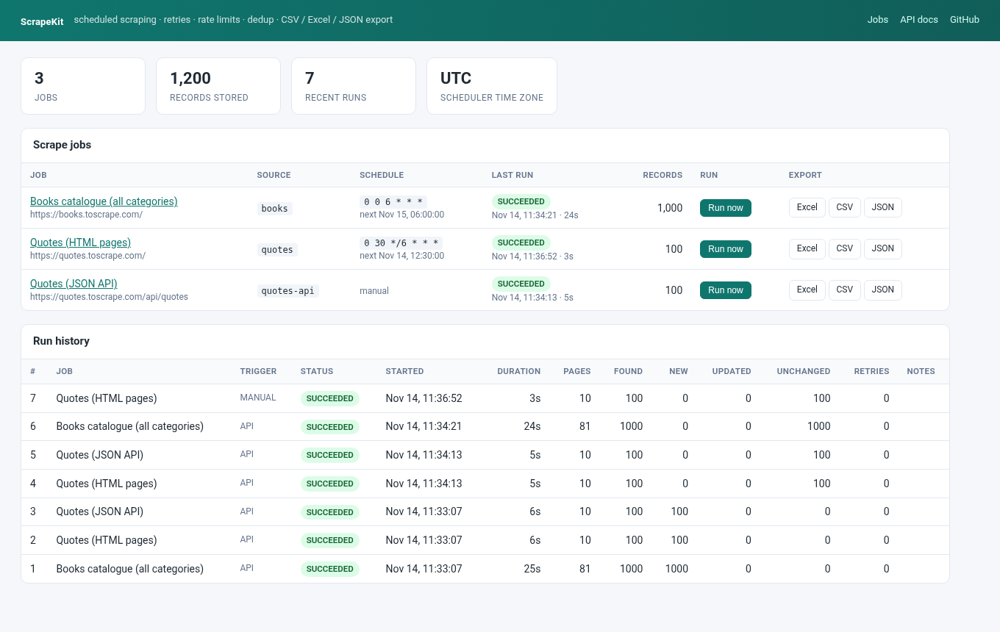
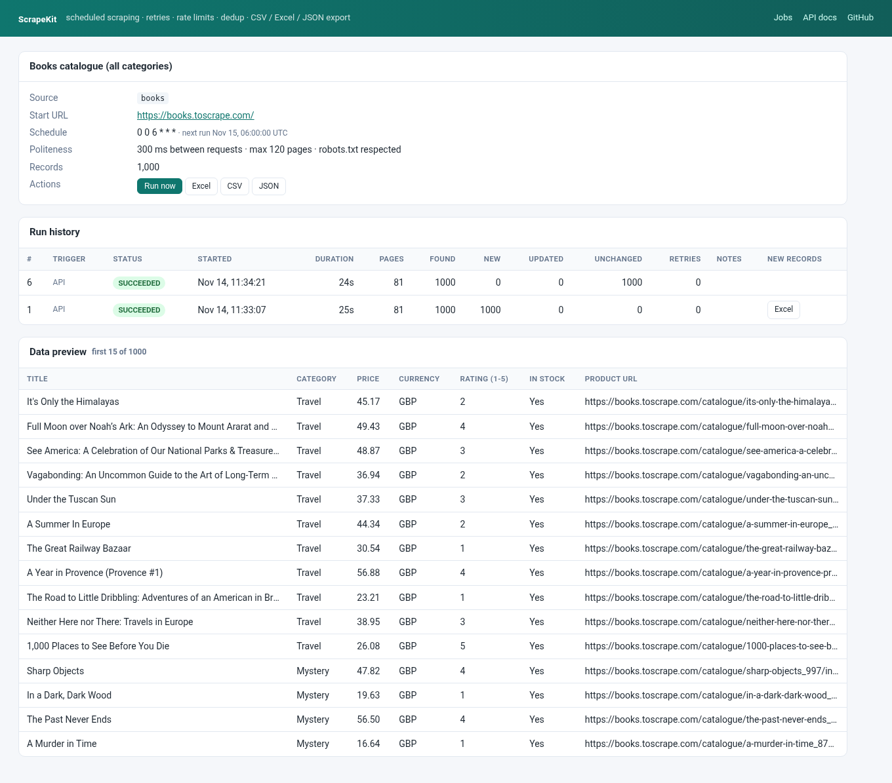
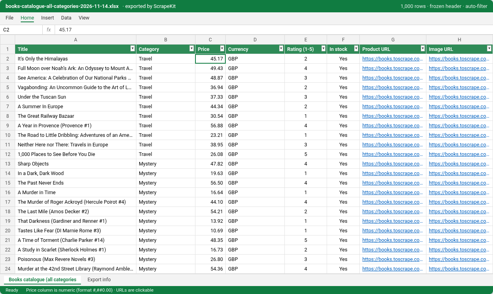
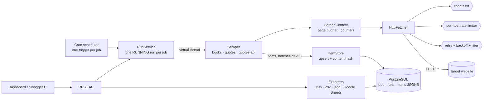

# ScrapeKit — scheduled web scraping with CSV / Excel / JSON export

[](https://github.com/solace202/scrapekit/actions/workflows/ci.yml)


ScrapeKit is a small production-style scraping service. You define **jobs** (what to scrape, how politely,
on which **cron** schedule), it crawls the site with **retries, per-host rate limiting and robots.txt
support**, stores a **deduplicated dataset** in PostgreSQL that tracks new and changed records, and lets you
download the data as **Excel, CSV or JSON**, or push it to **Google Sheets**.

The demo jobs scrape the public practice sites [books.toscrape.com](https://books.toscrape.com) (1,000
products in 50 categories, HTML pagination) and [quotes.toscrape.com](https://quotes.toscrape.com), both as
HTML and through its JSON API. A full catalogue crawl takes about 25 seconds (81 pages, 300 ms apart).



## Features

- **Three scraper types out of the box**, each a small `Scraper` class:
  - `books`: discovers every category from the home page, follows each category's *next* links and extracts
    title, category, price (decimal), star rating (1–5), stock status, product and image URLs;
  - `quotes`: HTML pages with a *Next* link;
  - `quotes-api`: a JSON API with `?page=N` and `has_next`.
  Adding a site means writing one class with Jsoup selectors (or JSON parsing) and a column list.
- **Polite, robust HTTP:**
  - minimum delay between requests **per host**, shared by all jobs;
  - **retries with exponential backoff and jitter** on timeouts, 429 and 5xx, honouring `Retry-After`;
    404 or 403 fail fast;
  - **robots.txt** is respected (longest-match Allow/Disallow, our own user-agent group first);
  - a **page budget** per job (`maxPages`), so a bad selector can never crawl forever.
- **Dedup and change detection.** Every record has a natural key (product URL, or author + quote). A run
  upserts in batches and counts **new / updated / unchanged** records using a SHA-256 hash of the canonical
  JSON. A product whose price changes shows up as *updated*, and its `changed_at` moves. Duplicates inside one
  crawl are skipped too.
- **Scheduling.** Spring 6-field cron per job (`0 0 6 * * *` = daily at 06:00) in a configurable time zone.
  Schedules are re-registered when a job is edited. A **partial unique index** guarantees one running run per
  job, even with several instances. Runs left behind by a crash are marked failed on startup.
- **Run history.** Status (`SUCCEEDED`, `PARTIAL` when a later page failed but earlier data was kept, `FAILED`),
  pages, records found / new / updated / unchanged, retries, duration and error message.
- **Exports**, all streamed (memory stays flat for large datasets):
  - **Excel (.xlsx)**: typed cells (prices are numbers with `#,##0.00`), styled and frozen header,
    auto-filter, clickable links, sensible column widths, plus an *Export info* sheet;
  - **CSV**: RFC 4180, UTF-8 with BOM so Excel shows accents correctly, and protection against
    **CSV formula injection** (`=HYPERLINK(...)` in scraped text is neutralised);
  - **JSON**: an array with typed fields and first/last-seen timestamps;
  - `?newInRun={runId}` exports only the records a given run discovered ("what's new today");
  - **Google Sheets (optional):** replaces a tab's content through the Sheets API with a service account.
- **Web dashboard** (Thymeleaf): jobs with next run time, *Run now*, download buttons, run history and a data
  preview. **Swagger UI** for the REST API. Actuator health probes, RFC 9457 problem responses.
- **Tests:** 45 unit and integration tests. Parsers are tested against pages saved from the real sites;
  integration tests run the whole app against **PostgreSQL 16 (Testcontainers)** and a **WireMock fake
  website** (pagination, retries with 503 and `Retry-After`, 404 in the middle of a crawl, robots.txt, price
  changes, concurrent runs, cron firing, Excel/CSV/JSON/Sheets output). CI never scrapes a real site.

| Run history and data preview | Excel export (opened from the download) |
| --- | --- |
|  |  |

## Architecture



## Quick start

Requirements: Docker. Nothing else; the image builds the app.

```bash
git clone https://github.com/solace202/scrapekit.git && cd scrapekit
docker compose up -d --build
open http://localhost:8080            # dashboard, click "Run now"
open http://localhost:8080/swagger-ui.html
```

Three demo jobs are created on first start. Or drive it from the command line:

```bash
# run the catalogue job now (202 + the RUNNING run)
curl -s -X POST localhost:8080/api/jobs/1/runs

# poll it
curl -s localhost:8080/api/runs/1
# {"id":1,"jobId":1,"trigger":"API","status":"SUCCEEDED","pagesFetched":81,"itemsFound":1000,"itemsNew":1000,...}

# download the data
curl -s -OJ "localhost:8080/api/jobs/1/export?format=xlsx"
curl -s -OJ "localhost:8080/api/jobs/1/export?format=csv"

# create your own job: one category, every weekday at 07:00, 1 s between requests
curl -s localhost:8080/api/jobs -H 'Content-Type: application/json' -d '{
  "name": "Mystery books",
  "source": "books",
  "startUrl": "https://books.toscrape.com/catalogue/category/books/mystery_3/index.html",
  "delayMs": 1000,
  "cron": "0 0 7 * * MON-FRI"
}'
```

Run locally without Docker for the app: start only Postgres (`docker compose up -d postgres`), then
`mvn spring-boot:run`.

## API

| Method | Path | What it does |
| --- | --- | --- |
| `GET` | `/api/sources` | Built-in scrapers and their columns |
| `GET` `POST` | `/api/jobs` | List / create jobs |
| `GET` `PUT` `DELETE` | `/api/jobs/{id}` | Read / replace / delete a job (schedule is re-registered) |
| `POST` | `/api/jobs/{id}/runs` | Run now: `202`, or `409` if already running |
| `GET` | `/api/jobs/{id}/runs` | Run history, newest first |
| `GET` | `/api/runs/{runId}` | Status and counters of one run |
| `GET` | `/api/jobs/{id}/items?offset=&limit=` | Browse the deduplicated dataset |
| `GET` | `/api/jobs/{id}/export?format=xlsx\|csv\|json[&newInRun=]` | Download |
| `POST` | `/api/jobs/{id}/export/google-sheets` | Write to a Google Sheet (optional) |

## Google Sheets export (optional)

1. In Google Cloud, create a **service account**, enable the **Google Sheets API** and download a JSON key.
2. Share your spreadsheet with the service account's e-mail (Editor).
3. Mount the key and configure it:
   ```yaml
   # docker-compose.override.yml
   services:
     app:
       volumes: ["./google-sa.json:/run/secrets/google-sa.json:ro"]
       environment:
         SHEETS_CREDENTIALS_FILE: /run/secrets/google-sa.json
         SHEETS_SPREADSHEET_ID: 1AbC...your-id
   ```
4. `curl -X POST localhost:8080/api/jobs/1/export/google-sheets -H 'Content-Type: application/json' -d '{"sheetName":"Books"}'`

Without a key the endpoint answers `503` with these instructions; everything else works.

## Configuration

| Variable | Default | Meaning |
| --- | --- | --- |
| `DB_URL`, `DB_USER`, `DB_PASSWORD` | local `scrapekit` | PostgreSQL connection |
| `SCHEDULER_ENABLED` | `true` | Register cron jobs on startup |
| `SCHEDULER_ZONE` | `UTC` | Time zone for cron expressions |
| `SCRAPER_DEFAULT_DELAY` | `500ms` | Per-host gap when a job sets none |
| `SCRAPER_MAX_ATTEMPTS` | `4` | Attempts per URL (1 = no retry) |
| `SCRAPER_INITIAL_BACKOFF` / `SCRAPER_MAX_BACKOFF` | `1s` / `30s` | Backoff range; also caps `Retry-After` |
| `SCRAPER_RESPECT_ROBOTS` | `true` | Obey robots.txt |
| `SCRAPER_USER_AGENT` | `ScrapeKit/0.1 (+repo URL)` | Sent with every request |
| `SHEETS_CREDENTIALS_FILE`, `SHEETS_SPREADSHEET_ID` | empty | Google Sheets export |

## Adding a site

```java
@Component
public class MySiteScraper implements Scraper {
    public String id() { return "mysite"; }
    public String description() { return "Listings on example.com"; }
    public String defaultStartUrl() { return "https://example.com/listings"; }
    public List<Column> columns() {
        return List.of(Column.text("name", "Name"), Column.number("price", "Price"), Column.url("url", "URL"));
    }
    public void scrape(ScrapeContext ctx) {
        URI next = ctx.startUrl();
        while (next != null) {
            Document doc = Jsoup.parse(ctx.fetch(next).body(), next.toString());   // polite fetch, counted
            for (Element e : doc.select(".listing")) {
                String url = e.selectFirst("a").absUrl("href");
                ctx.emit(new ScrapedItem(url, Map.of("name", e.select("h2").text(),
                        "price", new BigDecimal(e.select(".price").text().replaceAll("[^0-9.]", "")), "url", url)));
            }
            Element n = doc.selectFirst("a.next");
            next = n == null ? null : URI.create(n.absUrl("href"));
        }
    }
}
```

Storage, dedup, retries, scheduling, history and all export formats come for free.

## Tests

```bash
mvn verify                        # needs Docker for Testcontainers
python3 scripts/test_report.py    # summary of the last run
```

## Project layout

```
src/main/java/dev/scrapekit
├── http/        HttpFetcher, RetryPolicy, HostRateLimiter, RobotsPolicy
├── scrape/      Scraper SPI, ScrapeContext, sources/ (books, quotes, quotes-api)
├── job/ run/    jobs, runs, async execution, history
├── item/        ItemStore (batched upsert, content hash)
├── export/      Excel, CSV, JSON, Google Sheets
├── schedule/    cron registration
└── web/         REST API, dashboard, problem responses
```

## Scraping responsibly

The demo targets are sandboxes built for scraping practice. For real sites, check the terms of service,
keep the delay generous, respect robots.txt (on by default) and don't collect personal data you don't need.

## License

MIT
